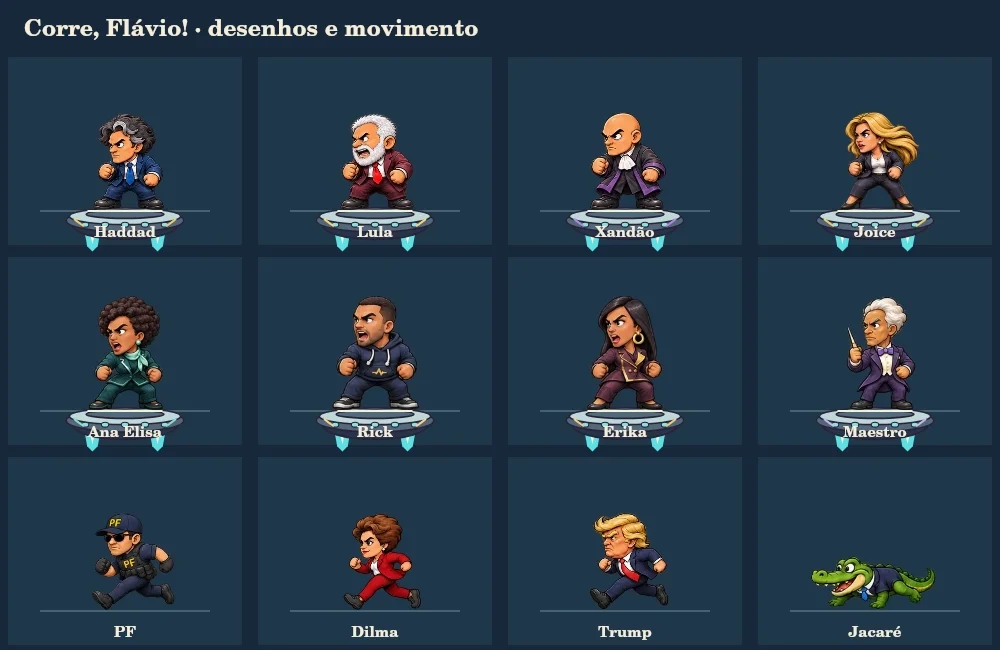

# Elenco e movimentação

A revisão anterior cobria os dez personagens vetoriais e a multidão. Esta etapa estende as novas ilustrações aos chefes clássicos, aliados, perseguidores, mascotes e uniformes regionais, e amplia as sequências da campanha também.

## Arte e movimento usados no jogo

São 18 atlas, com 568 posições de quadros completos: quatro poses principais e quatro desenhos intermediários por linha. Há linhas da mesma identidade em ações ou uniformes diferentes; a quantidade de linhas não representa personagens diferentes. Os desenhos aprovados de disparo do Flávio foram preservados nos atlas compartilhados. A corrida principal, o agachamento e o deslize mantêm suas artes e proporções.

Os ciclos de corrida acrescentam compressão do apoio, passagem do joelho, elevação do calcanhar e a passada oposta. O combate acrescenta respiração, entrada na preparação, continuação do lançamento e assentamento após o recuo. As poses essenciais continuam legíveis em movimento reduzido. Os retratos e as ações na pista também usam os redesenhos, sem voltar ao atlas antigo durante um ataque.

A corrida do Flávio era selecionada apenas pelo tempo decorrido a uma frequência fixa, mesmo quando a pista acelerava. Agora os oito desenhos acompanham a distância física: duas pisadas a cada 144 unidades do mundo, sem reiniciar o ciclo na mudança geográfica. As marcas discretas de contato acompanham essas duas pisadas. A física dos comandos, os tempos dos ataques e as regras permanecem no motor existente.

## Fontes e reprodução

`tools/redesign-art-sources.json` lista os PNGs originais em `assets/redesign/`, a ordem dos atores e as linhas preservadas. As novas ilustrações foram geradas usando cada atlas anterior como referência de identidade, traje e orientação, com oito poses completas por linha. Não são recortes de membros montados sobre um corpo genérico.

`node tools/build-redesigned-art.mjs` registra os desenhos em um atlas compacto e gera o manifesto. As poses principais conservam os índices públicos anteriores; os desenhos intermediários têm referências próprias. O modo `--metadata-only` destina-se apenas a mudanças na ordenação de poses, com dimensões de imagem inalteradas. `--check` refaz e compara a saída. `node tools/preview-redesigned-movement.mjs` reproduz a prévia acima com os renderizadores reais.

As fontes anteriores continuam no repositório. Os atlas novos substituem as mesmas chaves de carregamento, sem duplicar a quantidade de folhas carregadas. Os WebP novos usam qualidade 94 e alfa de qualidade 100. Nos 18 atlas substituídos, os bytes caíram de 20.475.972 para 11.858.462 e a área decodificada caiu de 28.305.636 para 25.075.477 pixels. Isso mede os arquivos e as dimensões, não FPS ou latência em um celular físico.

## Validação

- Regressão local: 659 testes Node/Canvas passaram antes dos dois testes adicionais de renderização e passada. Os testes finais focados passaram, incluindo oito silhuetas reais de corrida no Canvas, orientação, retratos, arma e poses baixas do Flávio.
- 20/20 campanhas simuladas chegaram à urna, concluíram a lição e fizeram os cinco voos na ordem correta, totalizando 100 pousos.
- Versões dos recursos e ausência de erros no diff verificadas. A suíte completa do Chrome é executada pelo CI, pois a abertura local do Chromium é bloqueada pelo ambiente.

Base de retorno desta etapa: `3bfe0df75b2ec8a44764c14ab08edf0ebc410345`.
