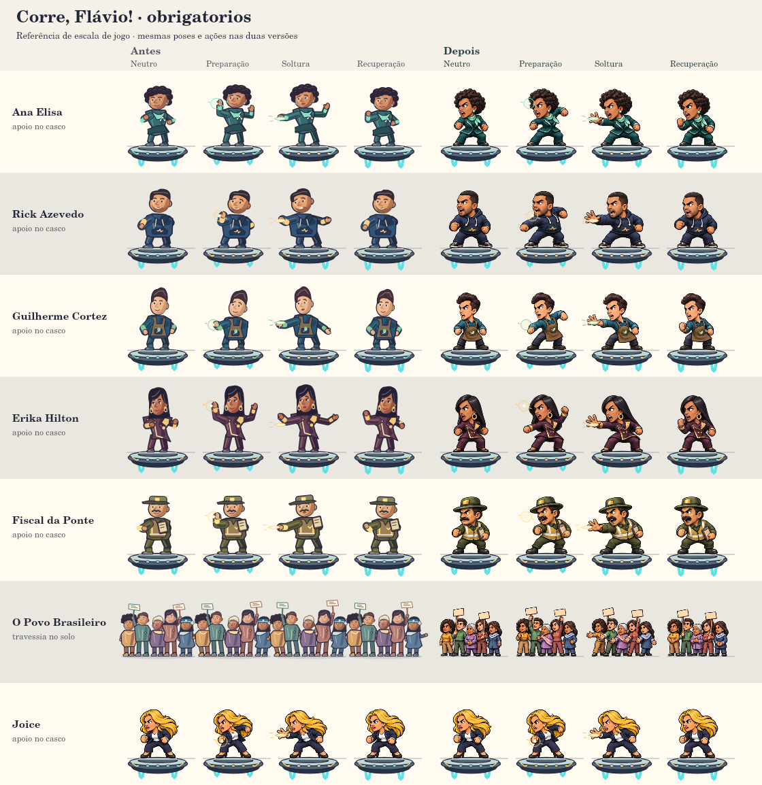
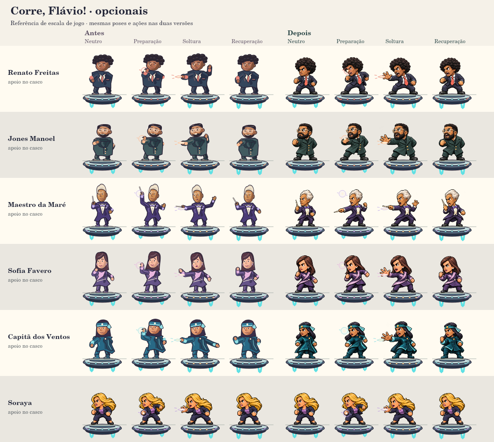

# Redesenho do elenco pendente

Os dez personagens da campanha e a multidão ainda eram desenhados por funções vetoriais, com aparência diferente dos sprites ilustrados do elenco anterior. A revisão de agachamento/deslize do Flávio não resolvia essa diferença.

Esta revisão substitui a apresentação de Ana Elisa, Rick Azevedo, Guilherme Cortez, Erika Hilton, Fiscal da Ponte, Renato Freitas, Jones Manoel, Maestro da Maré, Sofia Favero, Capitã dos Ventos e O Povo Brasileiro. São 44 quadros completos: neutro, preparação, soltura/sinalização e recuperação. Os retratos recortam a mesma arte neutra. Joice e Soraya aparecem apenas como referências de estilo nas comparações.

As ilustrações foram geradas a partir do atlas `combat-original-a-v1.png` como referência de acabamento e de pranchas renderizadas dos personagens existentes como referência de identidade, cores e trajes. O briefing foi: caricaturas com cabeças expressivas, contornos escuros, sombreado e roupas detalhadas; corpo inteiro, quatro poses distintas, fundo transparente, sem plataforma ou projéteis incorporados. A multidão mantém cinco cidadãos e sinaliza uma passagem pacífica.

Os PNGs fontes são preservados em `assets/campaign-illustrated-{a,b,c}-v1.png`. `node tools/build-campaign-art.mjs` produz as versões WebP lossless e os recortes/pivôs; `--check` verifica a reprodução. Nenhum membro é montado separadamente. O carregamento essencial inclui os três atlas antes da partida; a apresentação vetorial anterior permanece como fallback de carregamento. Os pontos físicos de lançamento, os controles e as regras não foram alterados.

## Comparação renderizada pelo jogo

## Validação local

- 657 testes Node e Canvas nativo aprovados, sem falhas nem testes ignorados, incluindo atlas/retratos novos, poses distintas, apoio dos pés, carregamento e mecânica existente.
- As versões de recursos e a reprodução dos atlas passaram nas verificações.
- A execução local do navegador foi bloqueada pelo ambiente ao abrir o socket do Chromium. O fluxo de CI executa os testes do navegador no Chrome, incluindo carregamento das novas artes na comparação de pixels.

Base para retorno: `832684502e74b7f0a235a4c313c1b9cff0255843`.
