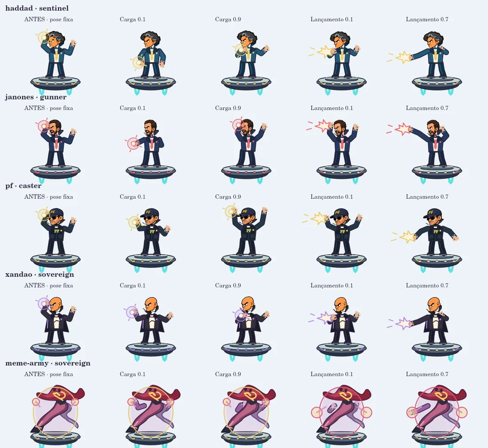
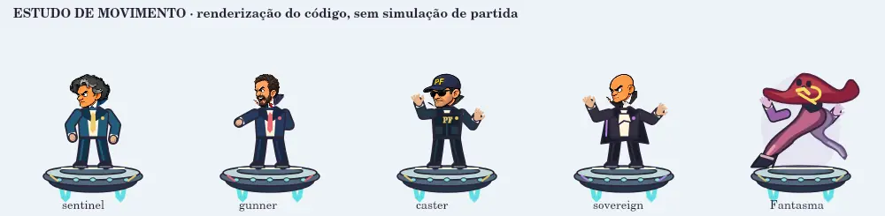

# Pesquisa, comparação e correções do Corre, Flávio!

A revisão anterior confirmou regras e corrigiu bugs, mas não resolveu a expressividade dos movimentos nem demonstrou a qualidade das fases. Esta rodada comparou o código e os quadros renderizados com referências de construção de jogos e combate.

## Comparação verificável

| Antes: problema observado no código/render | Depois: mudança implementada |
|---|---|
| A seleção inicial era Infinito; a campanha solicitada dependia de trocar o modo | História selecionada ao abrir; Infinito continua disponível |
| Muitas respostas de esquiva usavam a mesma fórmula, independentemente da classe | Sentinela alterna tiros isolados; Artilheiro concentra três disparos no mesmo nível; Conjurador intercala alvos locais; Soberano combina respostas |
| Braços assumiam uma pose fixa de preparação/lançamento | Articulações interpolam movimentos de antecipação, extensão e recuperação; os pés permanecem no convés |
| O gesto não distinguia ameaça baixa, alta e alvo de chão | Arremesso baixo, varredura alta e conjuração acima da cabeça usam gestos diferentes |
| A preparação de uma munição pendente podia sumir; outra reserva ocultava o lançamento atual | Apresentação considera reserva, lançamento efetivo e ação da munição que acabou de sair |
| Fantasma era chamado com tempo zero e movimento reduzido forçado | Silhueta original do chapéu vermelho/pernas preservada, com movimento e braços espectrais articulados |
| Uma oscilação adicional no desenho afastava o corpo da coordenada usada pela mira | Nave e corpo usam a mesma posição do motor; regressão testa movimento normal e reduzido nos dois modos |
| Corredores da História não antecipavam a arma seguinte | Trecho de aproximação oferece um exemplo isolado da arma seguinte quando a pista está livre; os últimos 400 m não geram novas ameaças comuns |

O ensaio não substitui jacaré ou perseguição já em andamento. Não se interrompe o jogo para mostrar um tutorial. Os tempos, distâncias e amplitudes são decisões de implementação, não valores prescritos pelas fontes.

## Evidência visual

Quadros produzidos pelo código Canvas com as cabeças dos atlas reais. A primeira coluna é a versão anterior; as demais são momentos diferentes das novas animações. Não são imagens conceituais geradas.

Estudo animado do rig, com tempo controlado. Demonstra os movimentos implementados; não é gravação de uma partida nem prova de campanha completa.

## Pesquisa e força das evidências

- [Khalifa, Silva e Togelius (2019)](https://akhalifa.com/documents/level-design-patterns.pdf): análise exploratória de mais de 30 jogos 2D. Antecipação, zona segura e variação de ritmo orientaram a aproximação dos chefes. São padrões descritivos, não garantia de diversão.
- [Mike Stout — Boss Battle Design and Structure](https://www.gamedeveloper.com/design/boss-battle-design-and-structure): análise profissional sobre chefes como teste de habilidades e marcos de tensão/alívio. Orientou diferenciação de exigências e recuperação útil.
- [Capcom — Impact Man em Mega Man 11](https://news.capcomusa.com/mega_man/blog/2018/08/31/impact-man-piles-in-to-mega-man-11): exemplo oficial de ligação entre tema da fase, inimigos e chefe, com preparação de ações e transformação. Aplicação: armas existentes aparecem antes do confronto e o gesto comunica a ameaça.
- [Desenvolvedor de Death’s Gambit — Readability](https://www.gamedeveloper.com/game-platforms/designing-for-difficulty-readability-in-arpgs): relato sobre gestos e expectativas consistentes. Aplicação: ação anunciada corresponde à munição efetivamente lançada.
- [Hicks et al. — DiGRA 2018](https://dl.digra.org/index.php/dl/article/view/936/): framework de feedback baseado em 17 desenvolvedores e dois jogos analisados. Orientou feedback ligado ao estado real; não comprova que mais efeitos melhorariam este jogo.
- [Discussão r/gamedev (2023)](https://www.reddit.com/r/gamedev/comments/13zsyob): opiniões sobre antecipação, progressão, relação com a região e playtests. Usada como discussão prática, sem tratar opiniões ou votos como evidência científica. Conteúdo obtido pela busca; a abertura direta foi bloqueada.

A pesquisa completa, restrições de acesso e critérios estão em [documento de projeto](../../docs/superpowers/specs/2026-11-11-research-combat-design.md).

## Validação e limites

- Seis regressões novas falharam antes das mudanças e passaram depois. Duas verificações adicionais reproduziram o gesto de ação errada em rajada e a diferença entre desenho/mira com movimento ativo; ambas corrigidas.
- 287 testes locais aprovados, incluindo renderização Canvas nativa. Versões de recursos e diff sem erros.
- Piloto existente, usando somente comandos legais durante o combate: 40/40 vitórias nos 20 encontros em 480 e 900 px, sem escudo, imunidade ou vidas extras.
- Revisão independente encontrou e permitiu reproduzir outros quatro casos: aviso perdido no Infinito, ensaio bloqueado por bueiro, pés do Fantasma fora do convés e ação errada na recuperação. Foram corrigidos com regressões; 300 sequências com sementes verificam o ensaio nas etapas avançadas.
- Campanha completa automática com `node tools/check-story-campaign.mjs`: **20/20** percursos até a urna (dez sementes em duas larguras), usando comandos legais desde a largada, sem alterar HP, vidas, coletas, perigos ou relógios. O piloto considera o envelope maior do jacaré e as ampolas simultâneas. Não é playtest humano.
- CI de navegador acrescenta início direto na História, quadros de movimento e capturas; resultado final é registrado no PR antes da integração.

Não houve nesta rodada campanha inteira jogada manualmente, teste físico em celular/Safari nem pesquisa com jogadores. Estudos, testes automáticos e renderizações não autorizam afirmar ausência de qualquer bug, equivalência a Mega Man ou qualidade AAA.
